<div align="center">
  
  <br />
</div>


# Nexus AI

## Overview

**Nexus AI** is a real-time collaborative, agentic planning workspace designed to help software teams transform ideas into structured system diagrams and technical specifications.

Users can describe an architectural system in plain English, empowering a Google Gemini-powered AI agent to autonomously map that description onto a shared React Flow canvas. Beyond visual design, a secondary background AI agent converts the finalized canvas graph into a production-grade, multi-page Markdown technical specification. This acts as a comprehensive execution guide—detailing the system blueprint, tech stack, roadmap, and task breakdowns granular enough for human engineers and AI coding assistants to execute end-to-end.

## Architecture and UML Diagrams

These diagrams are written in Mermaid so they render directly in compatible Markdown viewers, including GitHub. They describe the current implementation: projects use their database ID as the Liveblocks room ID, access is either owner or email-based collaborator, and every authorized project member can edit the shared canvas and invoke AI workflows.

### High-Level Design

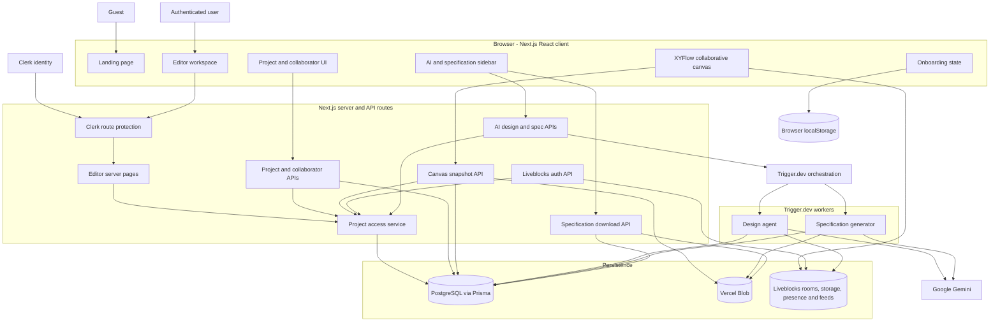

### Component Diagram

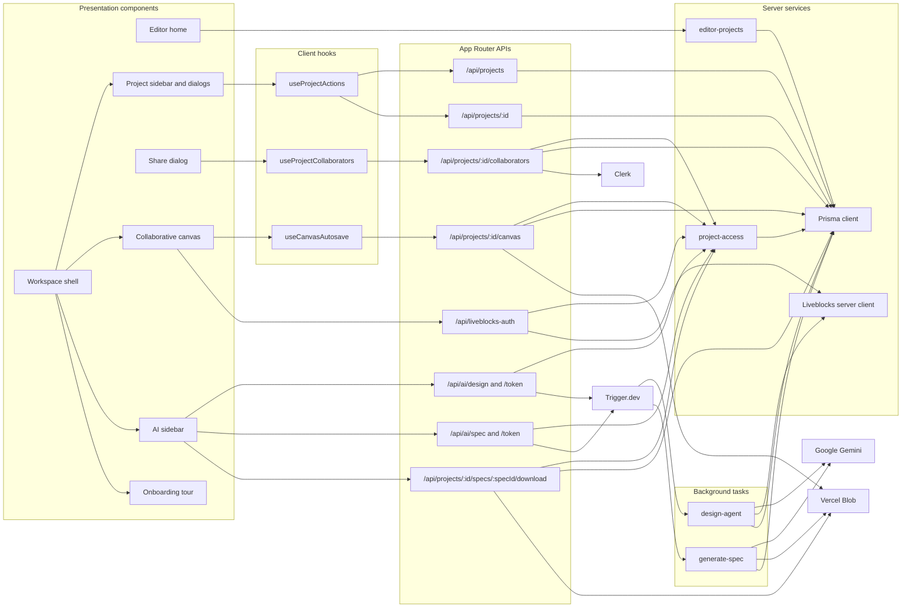

### Use-Case Diagram

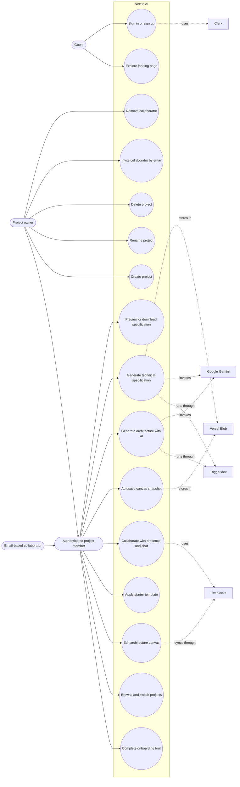

### Class Diagram

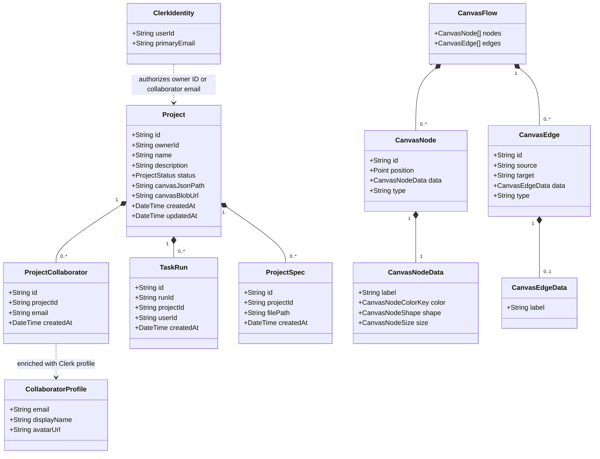

### Activity Diagram

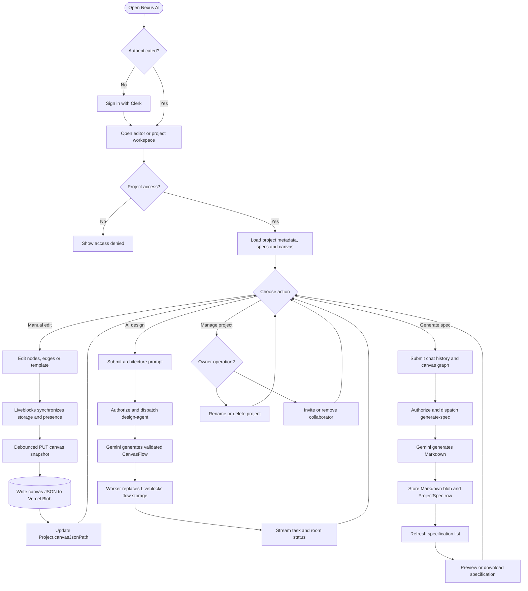

### Sequence Diagram 1: Authentication and Workspace Hydration

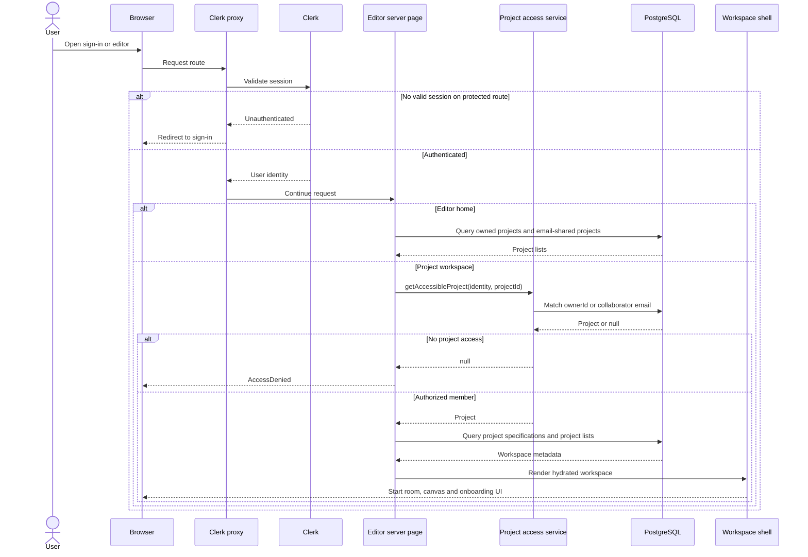

### Sequence Diagram 2: Project Lifecycle

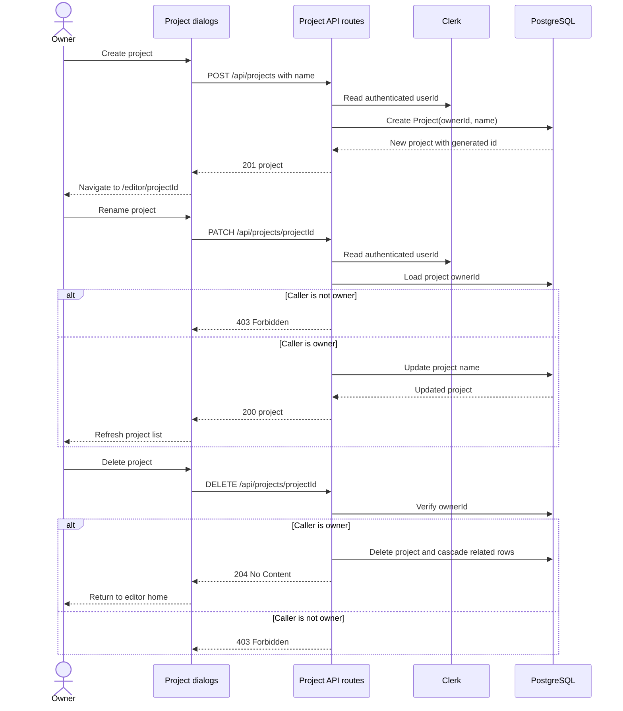

### Sequence Diagram 3: Collaborative Canvas and Autosave

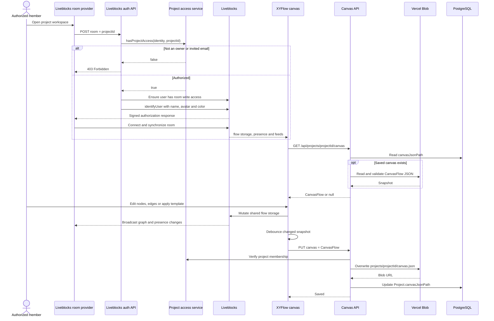

### Sequence Diagram 4: Collaborator Management

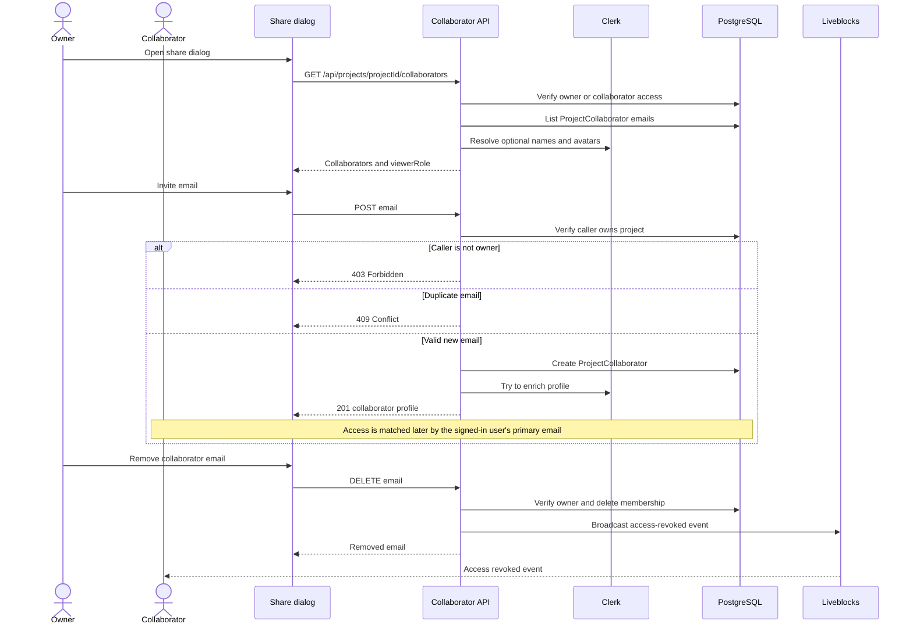

### Sequence Diagram 5: AI Architecture Generation

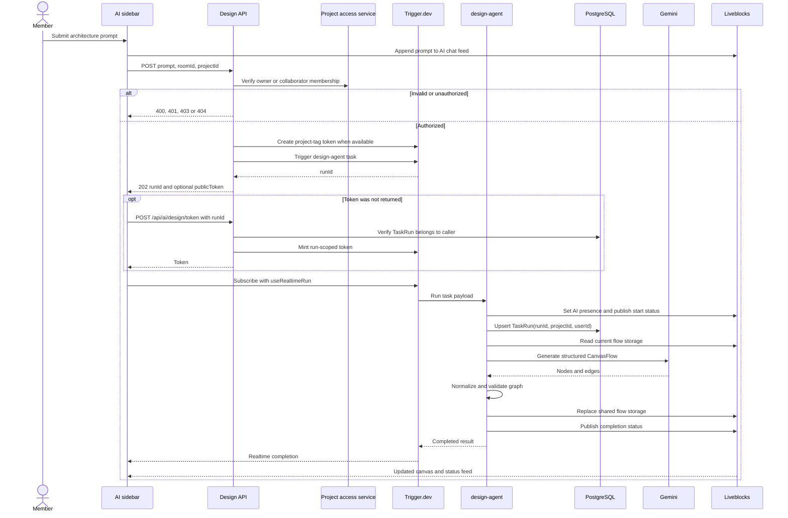

### Sequence Diagram 6: Specification Generation and Download

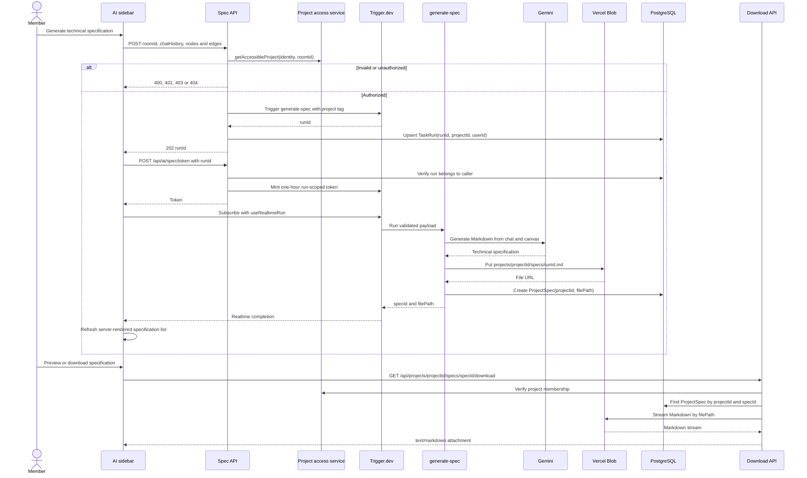

## Features

### AI & Automation

* **Agentic Architecture Generation:** Process natural-language prompts with Google Gemini to autonomously generate validated, structured node-and-edge graphs on the canvas.
* **AI-Powered Technical Specifications:** Convert the visual graph into a persistent, downloadable Markdown document detailing roadmaps, tech stacks, and step-by-step task breakdowns.
* **Durable Background Execution:** All complex AI and file generation tasks are reliably executed asynchronously using Trigger.dev, keeping the UI highly responsive.

### Collaboration

* **Real-Time Multiplayer Canvas:** Work inside shared project rooms utilizing Liveblocks, complete with live cursors, presence indicators, and simultaneous node/edge editing.
* **Integrated Communication:** Live chat with team members and an AI assistant directly within the workspace.
* **Starter Templates:** Quick-start capability with prebuilt architectural patterns (monolith, microservices, event-driven, serverless).

### Canvas Editor

* **Interactive Design:** Drag, resize, connect, and organize nodes with a robust XYFlow/React Flow-based editor.
* **Rich Customization:** Edit node labels inline directly on the canvas, and customize nodes with a floating toolbar and color swatches.
* **Reliable State Management:** Autosave canvas changes seamlessly with a debounced save flow.

### Security & Project Management

* **Authentication & Access Control:** Secure sign-in, sign-up, and protected routing powered by Clerk.
* **Workspace Management:** Manage multiple projects and restrict collaborative room access to authorized team members only.

## Tech Stack

### Frontend

* **Framework:** Next.js 16 (App Router) with TypeScript  
  
  
* **Styling:** Tailwind CSS, shadcn/ui, Radix UI  
  
  
  
* **Canvas & Interactivity:** XYFlow / React Flow, Framer Motion, GSAP, Three.js  
  
  
  
  
* **Auth:** Clerk (`@clerk/nextjs`)  
  

### Backend

* **Database:** Prisma ORM, PostgreSQL (via Neon)  
  
  
  
* **AI & Processing:** Google Gemini (`gemini-2.0-flash`), Trigger.dev  
  
  
* **Real-Time Synchronization:** Liveblocks Node/React  
  
* **File Storage:** Vercel Blob  
  

## Project Structure

```markdown
nexus-ai/
├── app/
│   ├── (auth)/             # Clerk sign-in / sign-up pages
│   ├── api/                # Core API routes (AI token logic, project CRUD, webhooks)
│   ├── editor/[roomId]/    # Protected collaborative workspace 
│   ├── layout.tsx          # Root layout & global providers
│   └── globals.css         # Global Tailwind & theme CSS
├── components/
│   ├── editor/             # Canvas, controls, edges, nodes, and collaboration UI
│   ├── dashboard/          # Project list and creation dialogs
│   └── ui/                 # Reusable shadcn/ui & Radix primitives
├── hooks/                  # Client-side hooks (autosave, keyboard shortcuts)
├── lib/                    # Core integrations (Prisma, Clerk, Gemini, Trigger.dev)
├── prisma/                 # PostgreSQL database schema and migrations
├── public/                 # Static assets
├── trigger/                # Trigger.dev background job definitions for AI tasks
└── types/                  # Shared TypeScript types & Zod schemas

```

### Key Directories

* **`app/api/`**: Contains thin route handlers that parse requests, assert Clerk authentication and project access, and dispatch durable tasks to Trigger.dev.
* **`components/editor/`**: Houses all React Flow and Liveblocks integration logic. It strictly owns the bridge between Liveblocks storage and React Flow state.
* **`hooks/`**: Manages client-side utility functions, including the autosave debouncing and canvas keyboard shortcuts.
* **`lib/`**: Centralizes client singletons and core service logic (e.g., Prisma db client, AI SDK setups, and authorization checks).
* **`trigger/`**: Isolates long-running operations (like AI spec generation) from the main web server threads via Trigger.dev background tasks.

## Core API Routes

| Method | Endpoint | Description |
| --- | --- | --- |
| **GET** | `/api/projects` | Fetches all projects for the authenticated user. |
| **POST** | `/api/projects` | Creates a new project workspace. |
| **GET / PATCH / DELETE** | `/api/projects/[projectId]` | Fetches, updates, or deletes a specific project. |
| **GET / PUT** | `/api/projects/[projectId]/canvas` | Loads and persists the latest canvas JSON blob. |
| **POST** | `/api/ai/design` *or* `/api/projects/[projectId]/generate` | Dispatches Trigger.dev task for AI architecture generation. |
| **POST** | `/api/ai/spec` *or* `/api/projects/[projectId]/spec` | Dispatches Trigger.dev task for Markdown specification generation. |
| **GET** | `/api/projects/[projectId]/specs/[specId]/download` | Streams the generated spec artifact for local download. |
| **GET / POST** | `/api/liveblocks-auth` | Issues a Liveblocks room token after access verification. |
| **GET / POST** | `/api/trigger` | Trigger.dev webhook handler for background task events. |

## Testing

### Recorded Unit Test Results

An earlier test run reported **9 passing test suites** and **123 passing tests**. The coverage report showed 100% statement, branch, function, and line coverage for the files included in that report: `lib/`, `lib/onboarding/`, and `types/`.

These figures describe the files included in the coverage run, not the entire application. The current `package.json` does not define a test script, and this checkout does not include the test configuration or test files needed to reproduce that run.

### Load Testing

The k6 scenarios are in `k6-tests/`. `07_mock_load.js` exercises a full API user journey: list projects, load a canvas, request room auth, and save the canvas. It uses the real Next.js routes and PostgreSQL queries, while Clerk/Liveblocks identity and Vercel Blob operations are mocked for local testing. This measures the app and database path, not capacity of those external services.

### Recorded k6 Run

One local run reached 200 VUs and completed 13,898 journeys (55,592 HTTP requests) over 7m01s:

| Metric | Result |
| --- | ---: |
| Peak virtual users | 200 |
| HTTP requests | 55,592 |
| Throughput | 131.87 requests/second |
| Failed HTTP requests | 0 (0.00%) |
| Completed journeys | 13,898 |
| Project list p95 | 868 ms |
| Room auth p95 | 735 ms |
| Canvas read p95 | 1.16 s |
| Canvas write p95 | 1.10 s |

All HTTP checks passed in that run. The four endpoint p95 values exceeded the script's configured latency thresholds (500 ms, 300 ms, 800 ms, and 1,000 ms respectively), so k6 reported a threshold failure even though the requests succeeded. These are observed local-test results, not a production capacity guarantee. The recorded run used an earlier load profile; the current script defaults to a 2-minute ramp to 200 VUs, a 5-minute hold, and a 1-minute ramp down.

### Run the 200-VU Scenario

Create `.env.load-test` in the project root with a valid `DATABASE_URL` and these settings:

```env
LOAD_TEST_MODE=true
MOCK_SERVER_URL=http://localhost:4001
DATABASE_URL=your_postgres_connection_string
```

Install dependencies, then open separate terminals in the project root:

```bash
npm ci
```

Start the mock integrations server:

```bash
node k6-tests/mock-server.js
```

Build and start Next.js with the load-test environment:

```bash
npx dotenv -e .env.load-test -- npm run build
npx dotenv -e .env.load-test -- npm run start
```

After the build succeeds and the app is running, run k6 from another terminal. Replace `your-project-id` with an existing project ID from `/editor/<project-id>`:

```bash
k6 run -e MAX_VUS=200 -e RAMP_DURATION=2m -e HOLD_DURATION=5m -e PROJECT_ID=your-project-id --summary-export=results-200vu.json k6-tests/07_mock_load.js
```

The default profile lasts about 8 minutes: 2 minutes ramping to 200 VUs, 5 minutes at 200 VUs, then 1 minute ramping down. The project must exist because the journey reads and updates its canvas. A threshold failure means one or more configured metrics missed their target; review the checks and latency thresholds separately from HTTP failure rate.

## Getting Started

### Prerequisites

* **Node.js**: v20+ recommended (v18+ minimum)
* **Package Manager**: `npm`, `yarn`, or `pnpm`
* **Database**: PostgreSQL (e.g., Neon)
* **External Accounts**: Clerk, Liveblocks, Trigger.dev, Vercel Blob, and Google AI Studio (Gemini)

### 1. Clone the Repository

```bash
git clone <repository_url>
cd nexus-ai
npm install

```

### 2. Configure Environment Variables

Create a `.env.local` file in the root directory and populate it with your keys:

```env
# Authentication (Clerk)
NEXT_PUBLIC_CLERK_PUBLISHABLE_KEY=your_clerk_pub_key
CLERK_SECRET_KEY=your_clerk_secret
NEXT_PUBLIC_CLERK_SIGN_IN_URL=/sign-in
NEXT_PUBLIC_CLERK_SIGN_UP_URL=/sign-up
NEXT_PUBLIC_CLERK_AFTER_SIGN_IN_URL=/editor
NEXT_PUBLIC_CLERK_AFTER_SIGN_OUT_URL=/sign-in

# Database
DATABASE_URL=your_postgres_connection_string

# Multiplayer (Liveblocks)
LIVEBLOCKS_PUBLIC_KEY=your_liveblocks_pub
LIVEBLOCKS_SECRET_KEY=your_liveblocks_secret

# Background Jobs (Trigger.dev)
TRIGGER_PROJECT_REF=proj_your_trigger_project_id
TRIGGER_SECRET_KEY=your_trigger_secret_key

# AI (Google Gemini)
GOOGLE_API_KEY=your_gemini_api_key

# Storage (Vercel Blob)
BLOB_READ_WRITE_TOKEN=your_vercel_blob_token

```

### 3. Set Up the Database

Run Prisma to sync your schema with your database:

```bash
npx prisma generate
npx prisma db push

```

> **Note:** For production environments, use `npx prisma migrate deploy` instead of `db push`.

### 4. Run the Development Servers

You will need to run the Next.js app and the Trigger.dev worker concurrently. Open two separate terminal windows:

**Terminal 1 (Next.js App):**

```bash
npm run dev

```

**Terminal 2 (Trigger.dev Worker):**

```bash
npm run trigger:dev

```

Open `http://localhost:3000` in your browser to start building.

## User Workflow

A typical user journey through Nexus AI involves the following data flow:

1. **Initiation:** A user signs into the app via Clerk, opens or creates a project workspace, and submits a natural-language description of their desired architecture.
2. **Architecture Generation:** The request hits the AI API route, which instantly responds to the client while dispatching a durable Trigger.dev background task to call the Gemini API.
3. **Real-Time Sync:** The Trigger.dev worker parses the Gemini response into a structured graph and writes it directly to Liveblocks Storage. All connected clients see the nodes and edges instantly appear on the canvas.
4. **Collaborative Editing:** Team members manually edit the architecture together in real-time, utilizing live chat, inline label editing, and autosaving features.
5. **Spec Conversion:** Once the design is finalized, the user triggers the documentation generation. Another background task prompts Gemini to expand the visual graph into a comprehensive, multi-page Markdown specification.
6. **Persistence & Handoff:** The final Markdown artifact is saved to Vercel Blob, and a metadata record is stored in PostgreSQL. The user can review, download, or hand off the spec directly to an AI coding assistant.

---

**Built for modern product teams that want to design systems faster, collaborate better, and turn ideas into production-ready technical specs.**

---

## Contributing

Contributions are welcome! Built for modern product teams that want to design systems faster and collaborate better. If you have an idea for an improvement:

1. Fork the repository
2. Create a feature branch (`git checkout -b feature/AmazingFeature`)
3. Commit your changes (`git commit -m 'Add some AmazingFeature'`)
4. Push to the branch (`git push origin feature/AmazingFeature`)
5. Open a Pull Request
